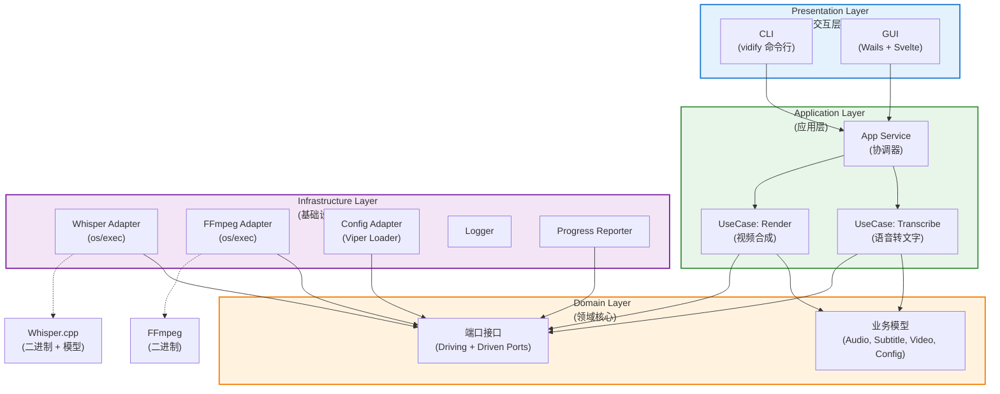

# Vidify 系统架构

## 架构概述

Vidify 采用 **Clean Architecture（六边形架构）** + **Modular Monolith** 设计，核心目标是：

- 高可维护性与可测试性（单人开发友好）
- 清晰的依赖方向（外层依赖内层）
- 便于从 CLI 平滑演进到 GUI

所有外部依赖（Whisper.cpp、FFmpeg、Viper 等）都被隔离在 Infrastructure 层，Domain 层完全不依赖任何外部库。

---

## 分层架构图



---

## 核心设计原则

依赖倒置（Dependency Inversion）：高层模块不依赖低层模块，两者都依赖抽象（端口）
领域层独立：domain 层零外部依赖，是整个项目的核心
端口与适配器：Driving Ports（主端口）由 CLI/GUI 调用，Driven Ports（被驱动端口）由 Infrastructure 实现
Use Case 显式化：每个主要业务流程都有独立的 Use Case（Transcribe / Render）

---

## 项目目录结构简要

```text
internal/
├── domain/
│   ├── port/               # driving.go (Processor, Result) + driven.go (Transcriber, VideoMerger, ProgressReporter, Logger)
│   ├── audio.go
│   ├── config.go           # Config struct — includes TaskID / TaskCacheDir fields
│   ├── subtitle.go
│   ├── video.go
│   └── errors.go
├── application/
│   ├── usecase/
│   │   ├── transcribe.go
│   │   └── render.go
│   └── service.go          # Allocates task cache dir via injected taskDirFn; cleans up on success
├── infrastructure/
│   ├── appdir/             # App data directory authority (~/.vidify/* paths)
│   │                       #   • TaskDir(id) → ~/.vidify/cache/tasks/<id>/
│   ├── whisper/            # port.Transcriber implementation
│   ├── ffmpeg/             # port.VideoMerger implementation
│   ├── config/             # Viper config loader (produces domain.Config)
│   ├── logger/             # port.Logger implementation
│   │                       #   • Console: slog TextHandler → os.Stderr
│   │                       #   • File: slog JSONHandler → lumberjack (rotation)
│   │                       #   • Combined via slog.NewMultiHandler (Go 1.26+)
│   └── progress/           # port.ProgressReporter implementation (mpb)
├── adapter/
│   └── cli/                # Cobra commands; calls di.Build(), never imports infra directly
├── di/
│   └── wire.go             # Single composition root: wires all infra → use cases → service
└── common/
    └── errors/             # Shared error utilities (future use)
```

---

## 外部工具与模型解析策略

### 二进制解析（whisper-cli / ffmpeg）

`vidify` 在 `internal/adapter/cli/root.go` 中实现**三段式解析**：

1. **显式配置**（最高优先级）
   CLI flag / 环境变量 / `~/.vidify/config.yaml` 中的 `whisper-bin` / `ffmpeg-bin` 键。
2. **发布包内置二进制**
   可执行文件同级目录下的 `runtime-tools/<tool>/<os>-<arch>/`，
   例如 `runtime-tools/whisper/windows-x64/whisper-cli.exe`。
3. **系统 PATH**（兜底）
   按裸名 `whisper-cli` / `ffmpeg` 在 PATH 中查找。

> 该逻辑位于 CLI Adapter 层，因为"发现已安装二进制"是部署关切，不属于 Domain 或 Application。

### 模型文件分发策略

Whisper 模型（`.bin`）**绝不随发布压缩包一起分发**，原因如下：

- 单个模型最小约 75 MB（tiny），最大约 3 GB（large-v3）
- 存在多个多语言变体（`-en`、`-q5_0` 等），用户按需下载
- 打包进 zip 会使发布体积不可接受

用户应将模型手动下载至 `~/.vidify/models/ggml-<model>.bin`。
模型路径由 `appdir.Models()` 权威管理，`whisper` 适配器通过 `cfg.WhisperModelDir` 取得，不做任何路径猜测。

### 任务缓存生命周期

每次 `ProcessFile` 调用在 `~/.vidify/cache/tasks/<task-id>/` 下分配一个隔离工作目录，用于：

- FFmpeg 滤镜脚本（`vidify-filter.txt`）
- Whisper SRT 草稿（`<audio-basename>.srt`，成功后移至最终输出目录）

**清理策略：**

| 场景 | 行为 |
|------|------|
| 任务成功 | 立即删除整个 task 目录（`os.RemoveAll`） |
| 任务失败 | 保留 task 目录，日志中记录路径供排查 |
| 无缓存目录（测试/降级） | 适配器回退至 `os.TempDir()`，不影响功能 |

`appdir.TaskDir(taskID)` 是任务目录的**唯一权威**。
`Service` 通过构造时注入的 `taskDirFn` 调用它，保持 Application 层不依赖 Infrastructure 包。
