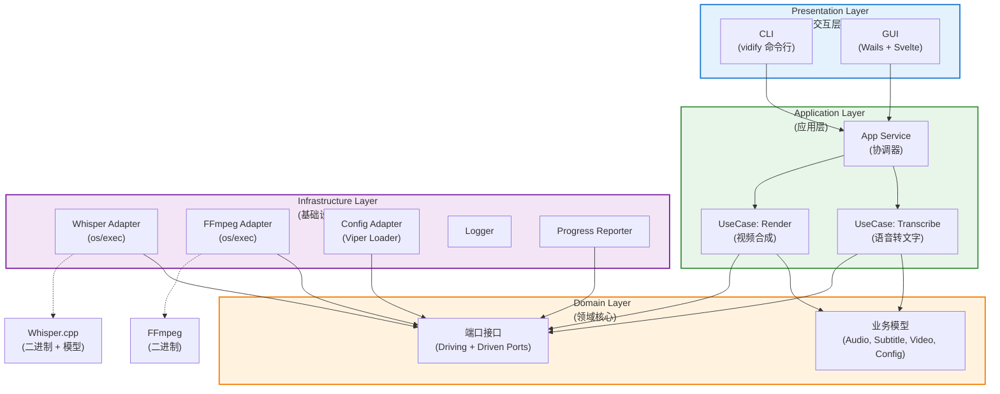

# Vidify 系统架构

## 架构概述

Vidify 采用 **Clean Architecture（六边形架构）** + **Modular Monolith** 设计，核心目标是：

- 高可维护性与可测试性（单人开发友好）
- 清晰的依赖方向（外层依赖内层）
- 便于从 CLI 平滑演进到 GUI

所有外部依赖（Whisper.cpp、FFmpeg、Viper 等）都被隔离在 Infrastructure 层，Domain 层完全不依赖任何外部库。

---

## 分层架构图



---

## 核心设计原则

依赖倒置（Dependency Inversion）：高层模块不依赖低层模块，两者都依赖抽象（端口）
领域层独立：domain 层零外部依赖，是整个项目的核心
端口与适配器：Driving Ports（主端口）由 CLI/GUI 调用，Driven Ports（被驱动端口）由 Infrastructure 实现
Use Case 显式化：每个主要业务流程都有独立的 Use Case（Transcribe / Render）

---

## 项目目录结构简要

```
internal/
├── domain/
│   ├── port/               # driving.go (Processor, Result) + driven.go (Transcriber, VideoMerger, ProgressReporter, Logger)
│   ├── audio.go
│   ├── config.go
│   ├── subtitle.go
│   ├── video.go
│   └── errors.go
├── application/
│   ├── usecase/
│   │   ├── transcribe.go
│   │   └── render.go
│   └── service.go
├── infrastructure/
│   ├── whisper/            # port.Transcriber implementation
│   ├── ffmpeg/             # port.VideoMerger implementation
│   ├── config/             # Viper config loader
│   ├── logger/             # port.Logger implementation (slog-backed)
│   └── progress/           # port.ProgressReporter implementation (mpb)
├── adapter/
│   └── cli/                # Cobra commands; calls di.Build(), never imports infra directly
├── di/
│   └── wire.go             # Single composition root: wires all infra → use cases → service
└── common/
    └── errors/             # Shared error utilities (future use)
```
