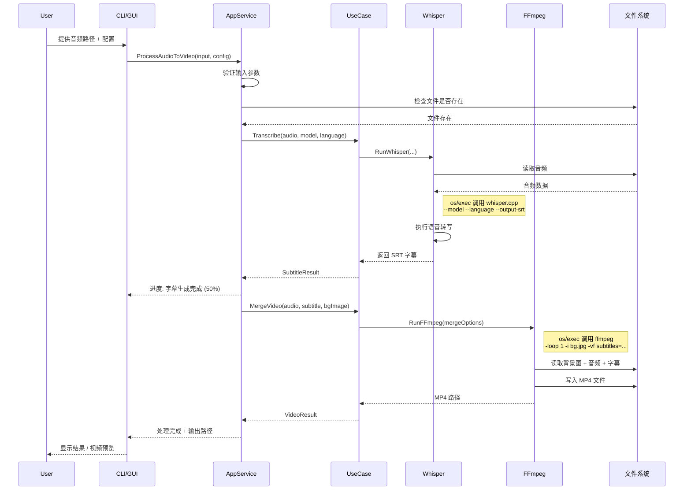
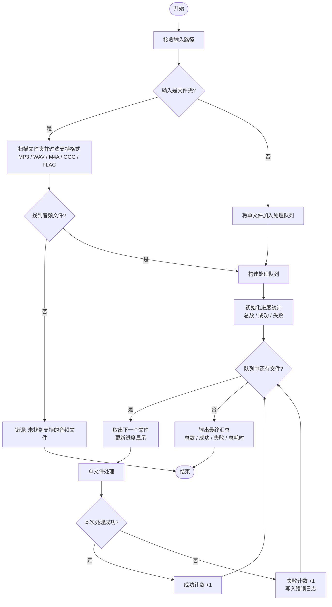

# Vidify 核心处理流程图

## 单文件处理流程（时序图）

展示一次完整的音频转视频处理过程中各组件的交互。

---

## 批量处理流程（活动图）

---

## 错误处理策略

| 阶段         | 可能错误                | 处理方式                      |
| ------------ | ----------------------- | ----------------------------- |
| 输入验证     | 文件不存在、格式不支持  | 立即返回错误提示              |
| Whisper 转写 | 模型文件缺失、内存不足  | 提示下载模型 / 建议切换小模型 |
| FFmpeg 合成  | FFmpeg 未安装、编码失败 | 检测 PATH、提示安装指引       |
| 文件写入     | 磁盘空间不足、权限不足  | 提示清理空间 / 检查目录权限   |
